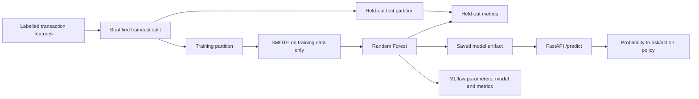

# Fraud Detection MLOps

**A reproducible imbalanced-class training workflow connected to a typed FastAPI prediction service.**

The project combines training-only SMOTE, a Random Forest, MLflow experiment tracking, a fixed inference feature contract, Docker packaging and GitHub Actions checks.

## Evaluation results

Reported on the project's held-out evaluation dataset:

| Metric | Result |
|---|---:|
| Recall | **91.18%** |
| Precision | **83.78%** |
| F1 | **87.32%** |
| Accuracy | **99.96%** |

Recall and precision matter together for an imbalanced problem: a model can look accurate while missing the rare class. These are project dataset results, not measured outcomes on a deployed financial service.

## Pipeline



[`src/train.py`](src/train.py) performs the split **before** resampling, keeping synthetic training samples out of the held-out partition. It records model parameters and evaluation metrics in MLflow, then saves the fitted model.

[`src/predict.py`](src/predict.py) validates the request shape with Pydantic and explicitly orders the seven inference features: `amount`, `hour`, `v1`, `v2`, `v3`, `v4`, `v5`.

## Model output and deterministic policy

| Fraud probability | Risk | Suggested action |
|---|---|---|
| Greater than 0.70 | High | Block |
| Greater than 0.40 and at most 0.70 | Medium | Review |
| At most 0.40 | Low | Approve |

The trained model supplies a probability; ordinary application code maps it to a policy. The API returns that recommendation without executing a payment or account action.

```json
{
  "fraud": true,
  "fraud_probability": 0.92,
  "risk": "high",
  "action": "block"
}
```

This is an illustrative response shape.

## Reproduce the workflow

Use an isolated Python environment with the packages imported by the source: `pandas`, `numpy`, `scikit-learn`, `imbalanced-learn`, `mlflow`, `fastapi`, `uvicorn` and `pytest`.

Provide an appropriately licensed labelled dataset at `data/fraud.csv`, with the seven inference features and a `class` target. Keep training feature names/order consistent with the prediction contract.

```bash
python3 src/train.py
uvicorn src.predict:app --host 127.0.0.1 --port 8080
```

```bash
curl http://127.0.0.1:8080/health
curl -X POST http://127.0.0.1:8080/predict \
  -H 'Content-Type: application/json' \
  -d '{"amount":850,"hour":2,"v1":-3.1,"v2":3.2,"v3":-2.1,"v4":2.3,"v5":-1.2}'
```

The model artifact must exist before starting the API. Load only an artifact you trust: the current implementation uses Python pickle.

## Regression and deployment

```bash
python3 -m pytest -q tests
```

Latest local verification: **4 fixtures passed**. They cover feature-order expectations, risk/action examples and response keys; they are lightweight contract fixtures, not HTTP or model-quality integration tests.

[`Dockerfile`](Dockerfile) describes build-time model training followed by Uvicorn serving on port 8080. Building it requires supplying its `requirements.txt` and training-data inputs, which are absent from the inspected public snapshot. [GitHub Actions](.github/workflows/ci.yml) runs the repository's checks.

For operational SaaS and agent work, see [TQEN](https://tqentech.com), [Crave It](https://craveitsyria.com), and the [architecture showcase](https://github.com/waelabokalam/production-systems-architecture).
